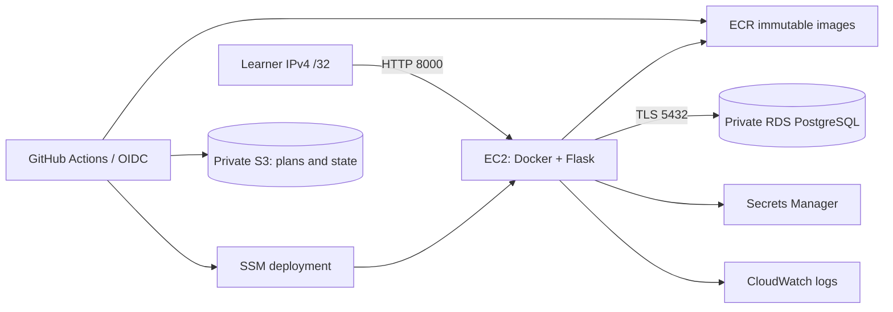

# Inventory Manager — Terraform, state recovery, and DockerA

A working inventory app and a guided infrastructure lab. Start with containers on your laptop, deploy to AWS, then practice diagnosing and recovering Terraform state problems on isolated disposable resources.

```powershell
docker compose up --build -d --wait
```

Open **http://localhost:8001**. Add a product, receive 10 units, remove 3, then try removing 8. The last change is rejected and the history retains the two successful adjustments.

```powershell
docker compose logs app
docker compose down
```

Stopping containers retains the local database volume. `docker compose down --volumes` deliberately deletes this project's local inventory.

## Learning path

| Milestone | What you learn | Checkpoint |
| --- | --- | --- |
| [1. Docker basics](docs/01-docker.md) | Images, layers, ports, networks, volumes, diagnostics | Data survives container recreation |
| [2. Terraform fundamentals](docs/02-terraform.md) | Resources, variables, outputs, modules, plans, state | Explain a plan before applying it |
| [3. Bootstrap and remote state](docs/03-state.md) | S3 migration, versioning, locking, state boundaries | Bootstrap and dev have separate state keys |
| [4. AWS deployment](docs/04-aws.md) | EC2, private RDS, ECR, IAM, SSM | Container connects to RDS over verified TLS |
| [5. GitHub delivery](docs/05-github.md) | Tests, image builds, saved plans, manual deployment, rollback | Running version matches the selected digest |
| [6. State break/fix drills](docs/06-state-drills.md) | Eight repeatable failure and recovery exercises | Every drill ends with a clean plan |
| [7. Operations and cleanup](docs/07-operations.md) | Logs, failure diagnosis, credential rotation, teardown | Dev state empty; bootstrap retained |

Each guide has commands, expected outcomes, hints, solutions, and a checkpoint. All Terraform and application code is supplied; exercises are separate from the reference implementation.

## Architecture



Locally, Compose runs Flask and PostgreSQL. AWS runs only the app container on EC2; the database is private RDS. No NAT gateway, load balancer, domain, or SSH key is required. This is an IP-restricted, single-user demo over HTTP, not a public production service.

## Project layout

```text
app/                    UI, inventory rules, runtime secret retrieval
infra/bootstrap/        State/release buckets, ECR, OIDC roles and boundary
infra/dev/              VPC, EC2, RDS, IAM, logging
infra/state-lab/        Disposable SSM parameter and fault fixtures
scripts/                Delivery helpers, Docker smoke test, material checks
tests/                  App, PostgreSQL and deployment contract tests
.github/workflows/      Checks, builds, manual plan/apply and rollback
docs/exercises/         Eight state incident runbooks with recovery steps
```

## Checks

Use Docker Desktop in Linux-container mode, Python 3.12–3.14, uv, Terraform 1.10+, and AWS CLI v2 for cloud lessons. CI uses Python 3.13, uv 0.9.5, and Terraform 1.16.1. Provider selections and Python dependencies are committed in lockfiles.

```powershell
uv sync --frozen --extra dev
uv run pytest -q
uv run python scripts/check_materials.py
terraform fmt -check -recursive infra
terraform -chdir=infra/dev init -backend=false -lockfile=readonly
terraform -chdir=infra/dev validate
terraform -chdir=infra/dev test
```

See [validation status](docs/validation.md) for executed checks and remaining cloud verification. `TEST_DATABASE_URL` must point only to a disposable database: tests recreate the application tables.

## Boundaries

- Region `us-east-2`, project `inventory-manager`, one `dev` environment. The examples and scoped IAM policies assume these names.
- EC2, public IPv4, RDS, storage, logs, snapshots, and Secrets Manager incur charges. Review current regional pricing before cloud milestones; stop or destroy lab resources when finished.
- AWS/GitHub execution is disabled until you configure the repository and set `LAB_READY=true`. Nothing in this project automatically creates a remote repository or provisions AWS from your laptop.
- State exercises use only `infra/state-lab` and `exercises/<lab-id>/terraform.tfstate`. Never inject faults into dev or bootstrap state.
- State restoration repairs Terraform's bookkeeping; it does **not** restore infrastructure or database data.

See [interface contracts](docs/contracts.md) for routes, environment variables, release files, and operational limits.
